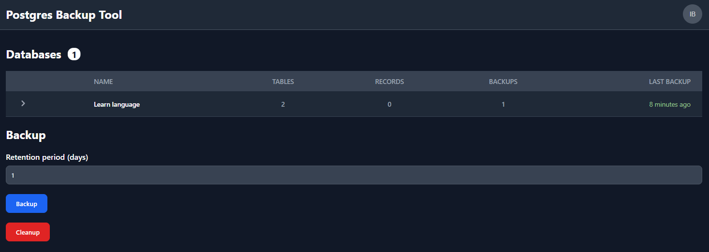

# postgres-azure-backup

PostgreSQL backups to private Azure Blob Storage, with a React management UI and
a native Rust/Loco backend.



## Features

- Multiple configured databases and schema-scoped backups/restores.
- Table counts, backup history, SQL export and single-use downloads.
- ZIP archives containing custom PostgreSQL dumps, plain SQL and mounted folders.
- Smart daily/weekly/monthly retention and expired-backup cleanup.
- Microsoft Entra gateway sessions, backend JWT role checks and CSRF protection.
- Transactional restores preserving application role ownership and sequences.

## Development and verification

Requires Rust (pinned in `server/rust-toolchain.toml`), Node 24+, Podman and
PostgreSQL 18 client utilities for running the backend outside its container.
`scripts/install_dependencies.sh` installs development dependencies on Ubuntu.

```bash
scripts/pod_up.sh
# Open http://localhost:8160
(cd server && cargo fmt --check && cargo clippy --locked --all-targets -- -D warnings && cargo build --locked)
(cd client && npm run lint && npm run typecheck && npm run build)
(cd test && npm ci && npx playwright test)
scripts/pod_down.sh
```

The pod runs two PostgreSQL databases, Azurite, mock OIDC, the Rust API, nginx and
Traefik. Tests exercise real database dumps/restores and storage through Playwright.
`SKIP_BUILD=1 scripts/pod_up.sh` reuses the server image and `client/dist`.
Frontend details: [client/README.md](client/README.md).

The native server image is identical across environments:

```bash
podman build -t localhost/postgres-azure-backup-server:test server
# Loco CLI, with local dependencies already running and storage configured:
cd server
LOCO_ENV=test cargo run -- start --no-banner
```

`LOCO_ENV=production` loads Key Vault secrets using Azure workload identity.
`LOCO_ENV=test` reads `DATABASES_CONFIG_PATH` and disables scheduling.
The API uses `/api`; readiness is `/healthz` on the same listener.

## Configuration

| Variable | Purpose |
|---|---|
| `LOCO_ENV` | `production` (container default) or `test` |
| `PORT`, `BINDING` | API listener; production defaults to 8080 / 0.0.0.0; test to 8168 |
| `AZURE_KEYVAULT_ENDPOINT` | Production vault URL |
| `AZURE_CLIENT_ID`, `AZURE_TENANT_ID`, `AZURE_FEDERATED_TOKEN_FILE` | Workload identity, injected by Kubernetes |
| `BACKUP_SCHEDULE_ENABLED` | Production smart scheduler, default true |
| `DATABASES_CONFIG_PATH` | Test JSON file; default `../test/databases_config.json` |
| `BLOBSTORAGE_CONNECTION_STRING` | Test storage connection string |
| `STORAGE_ACCOUNT_CONTAINER_NAME` | Test container, default `backups` |
| `OIDC_ISSUER`, `API_CLIENT_ID` | Test overrides; defaults match the mock OIDC pod |

Production retains the existing secrets: `tenant-id`, `api-client-id`,
`storage-account-blob-url`, `storage-account-container-name`, and `dbs-config`.
The private backup container must exist. The workload identity needs secret-read
and blob data permissions. Startup never migrates or seeds backed-up databases.

### Database configuration

`dbs-config` (production) or the test JSON file contains an array:

```json
[
  {
    "name": "my-app",
    "host": "postgres",
    "port": 5432,
    "database": "apps",
    "schema": "my_app",
    "username": "my_app",
    "password": "secret",
    "excludeTables": ["audit_log"],
    "folderBackups": [{ "path": "/app/storage/my-app" }]
  }
]
```

Use the login role that owns the configured schema. It needs CONNECT and CREATE
on the database, but no administrator privileges. Restore converts the custom
dump with `pg_restore --no-owner --no-acl`, then drops/recreates the schema through
`psql --single-transaction --variable=ON_ERROR_STOP=1`. Errors roll back the database
restore. Folder files are restored afterward, only to configured mounts.

Excluded tables retain their definitions but their data is omitted. Both custom
and plain SQL dumps are always created; legacy `dumpFormat` and `createPlainDump`
fields remain accepted and ignored, matching the preceding backend's behavior.

Folder paths must be absolute with distinct basenames per database. Missing or
non-directory mounts fail with an actionable PVC error. Backup collection does
not follow symlinks. Archives retain the existing layout:

```text
YYYYMMdd-HHmmss.rowCount.fileCount.filesTotalSize.retention.zip
├── database.pgdump
├── database.sql
└── folders/{configured-folder-basename}/{relative-file-path}
```

Existing archives with different dump filenames remain readable. Blob prefixes
remain the lowercased database name with non-ASCII-alphanumeric characters replaced
by `-`. Metadata comes from the UTC filename, preserving existing retention dates.

### Smart backups

Production runs smart backup immediately at startup, then 24 hours after each
completed run. `BACKUP_SCHEDULE_ENABLED=false` disables it. The prior backend's
documented `BACKUP_*_CRON` variables were unused; scheduling remains fixed-delay.

| Tier | Retention | Minimum interval |
|---|---|---|
| Monthly | 356 days | 30 days |
| Weekly | 30 days | 7 days |
| Daily | 7 days | 1 day |

Higher tiers satisfy lower-tier intervals. Each run creates at most one backup per
database and then cleans expired archives. Manual backup always uses seven days.

## Authentication and downloads

The gateway owns OAuth sessions; the UI reads `/oauth2/userinfo`. The API validates
RS256 JWT signature, issuer, audience, expiration, `api-access` scope and endpoint
roles (`readBackups`, `createBackup`, `restoreBackup`, `downloadBackup`).

All mutations, including gateway-injected bearer requests, require the host-only
Secure `__Host-XSRF-TOKEN` cookie echoed in `X-XSRF-TOKEN`. External clients obtain
the cookie through an authenticated GET first. Download-token creation requires
the download role and CSRF; `/api/download/{token}` accepts the resulting
30-second single-use capability. No private blob URLs are exposed.

## Deployment

CI checks Rust formatting/Clippy/build, React lint/types/static hosting and the
Playwright suite. Native images are published to numbered GHCR tags. Deploy with:

```bash
AZURE_KEYVAULT_NAME=p07-backup \
SERVER_IMAGE=ghcr.io/mucsi96/postgres-azure-backup-server:42 \
scripts/deploy.sh
```

Deployment uses `rust-app` 7.0.0 and `static-client-app` 5.0.0 with reset values,
preserving release names, gateway authentication, workload identity and the three
existing backup PVCs. The server runs as UID/GID 65532 with fsGroup 65532 for PVC
access; `/tmp` is a disk-backed emptyDir for dumps/archives. Memory remains 512Mi
to accommodate PostgreSQL child processes. No Java runtime or actuator is used.

p07 provisions Web auth, ForwardAuth, Redis and static storage. Deploy reads
`forward-auth-config.auth` and `client-storage-config`. Client assets are public,
documents are gateway-authenticated, and backup storage remains private. Static
deployment clears old assets, uploads new assets, then index; downtime is intentional.
Faro uses the compiled name `postgres-azure-backup-client` and the same-origin
`/_telemetry/collect`; there is no runtime configuration fetch.

## Local ports

8160: app gateway; 8161: gateway ping/dashboard; 8163: Azurite;
8164/8165: PostgreSQL; 8166: mock OIDC; 8168: API/readiness (pod only);
8169: optional Vite. New local ports must remain within 8160–8169.

Architecture and API details: [AGENTS.md](AGENTS.md).
